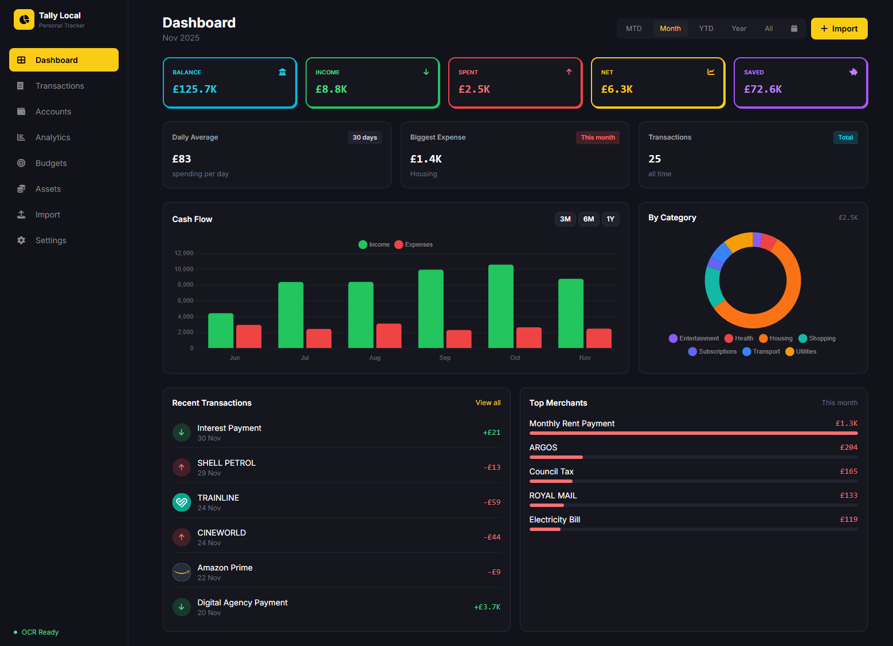
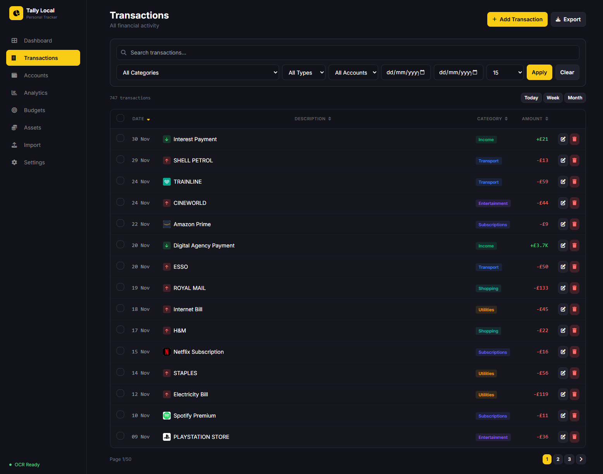
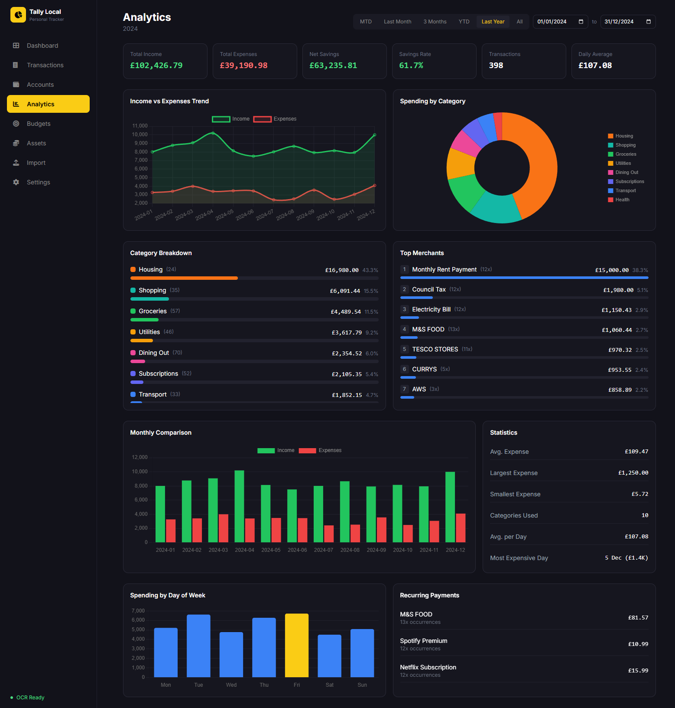
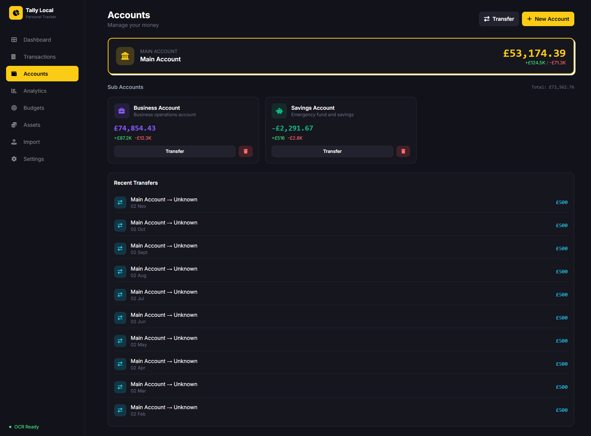
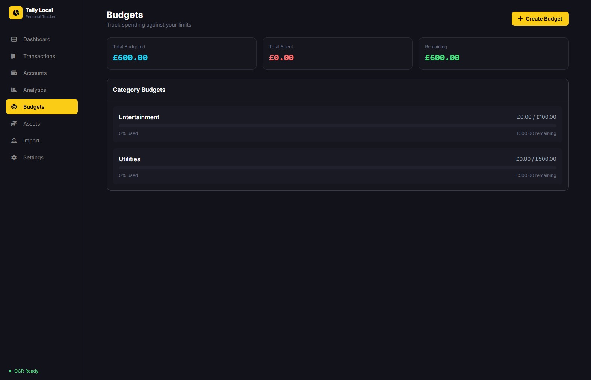
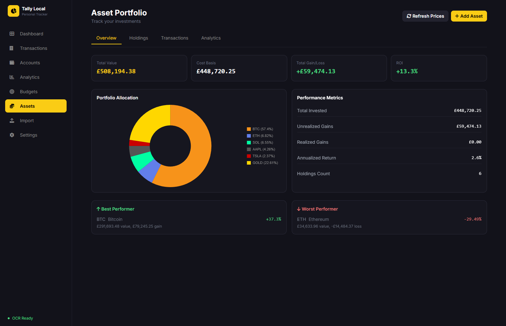
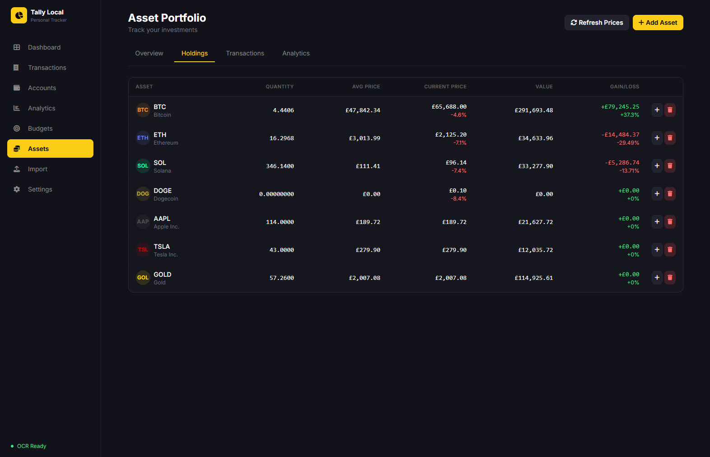
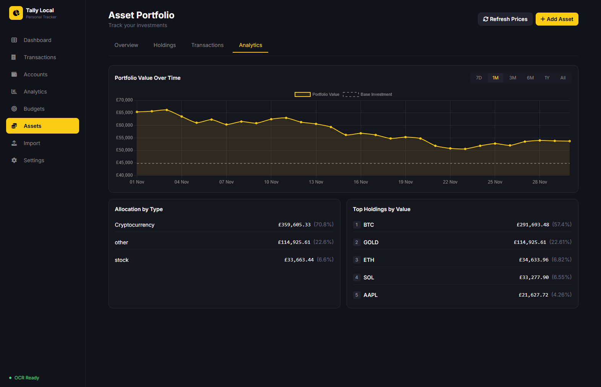
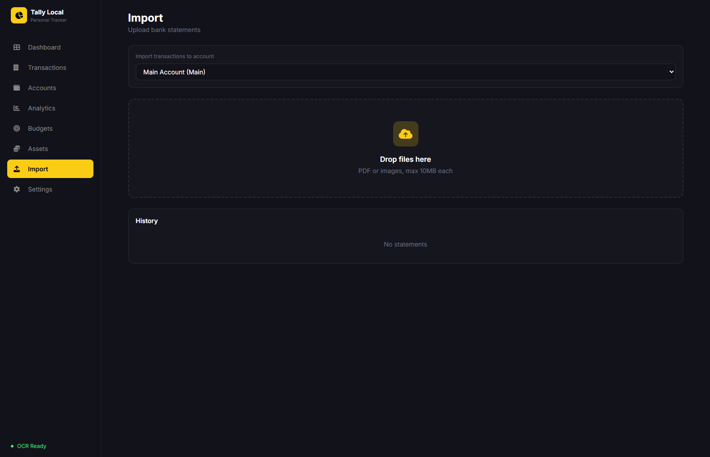
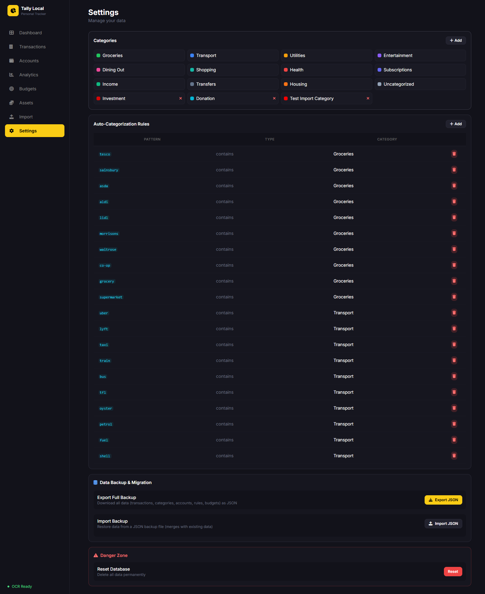

<p align="center">
  
  
  
  
</p>

<h1 align="center">💰 Tally Local</h1>

<p align="center">
  <strong>The personal finance tracker that respects your privacy.</strong><br>
  100% offline. Your data never leaves your device.
</p>

<p align="center">
  
  
  
  
</p>

---

## 🌟 Why Tally Local?

In a world where every finance app wants to connect to your bank, sell your data, or charge monthly fees, **Tally Local** takes a different approach:

- **🔒 Truly Offline** — Your financial data is stored locally in SQLite. No accounts, no servers, no data harvesting.
- **📄 Bank Statement OCR** — Import PDF/image bank statements with intelligent text extraction. No bank API connections needed.
- **💎 Asset Portfolio Tracking** — Track crypto and precious metals with live pricing from free public APIs.
- **📊 Beautiful Analytics** — Comprehensive dashboards, charts, and insights without compromising your privacy.
- **🆓 Forever Free** — No subscriptions, no premium tiers, no "pro" features locked behind paywalls.

---

## ✨ Features

### 💳 Banking & Transactions

| Feature | Description |
|---------|-------------|
| **OCR Statement Import** | Upload PDF or image bank statements and automatically extract transactions using PaddleOCR |
| **Multi-Account Support** | Track checking, savings, credit cards, cash, and investment accounts |
| **Smart Categorization** | Auto-categorize transactions with customizable rules |
| **Bulk Editing** | Edit multiple transactions at once with powerful batch operations |
| **Transfer Tracking** | Dual-entry accounting for transfers between accounts |
| **Merchant Recognition** | Automatic merchant detection with logo display |
| **Notes & Tags** | Add personal notes and tags to any transaction |

### 📈 Asset Portfolio Management

| Feature | Description |
|---------|-------------|
| **Cryptocurrency Tracking** | Support for 90+ cryptocurrencies with live CoinGecko pricing |
| **Precious Metals** | Track Gold (XAU), Silver (XAG), Platinum (XPT), and Palladium (XPD) |
| **Wallet Tracking** | Monitor Bitcoin, EVM (Ethereum, Polygon, BSC, etc.), and Solana wallets with historical balances |
| **Auto Wallet Sync** | Wallet balances auto-refresh daily (with manual sync controls when you need them) |
| **Portfolio Analytics** | ROI calculations, gain/loss tracking, and performance metrics |
| **Historical Charts** | Daily portfolio value charts with customizable date ranges (7D, 1M, 3M, 6M, 1Y, All) |
| **Transaction History** | Complete buy/sell/transfer records with cost basis tracking |
| **Custom Assets** | Add untracked assets with manual price entry |

### 📊 Analytics & Insights

| Feature | Description |
|---------|-------------|
| **Interactive Dashboard** | At-a-glance view of your financial health |
| **Spending Breakdown** | Category-wise expense analysis with charts |
| **Income vs Expenses** | Cash flow trends over time |
| **Period Comparisons** | MTD, Last Month, 3 Months, YTD, and custom date ranges |
| **Top Merchants** | See where your money goes most frequently |
| **Budget Tracking** | Set monthly budgets by category with progress indicators |

### 🛡️ Privacy & Data

| Feature | Description |
|---------|-------------|
| **Local SQLite Database** | All data stored on your machine |
| **Full Export/Import** | JSON backup for migration or peace of mind |
| **No Internet Required** | Core functionality works completely offline |
| **No Account Needed** | Just download and run — no sign-ups |

---

## 🚀 Quick Start

### Prerequisites

- Python 3.8 - 3.12 (required for PaddleOCR compatibility)
- pip (Python package manager)

### Installation (Local)

```bash
# Clone the repository
git clone https://github.com/yourusername/tally-local.git
cd tally-local

# Create virtual environment
python -m venv venv
source venv/bin/activate  # On Windows: venv\Scripts\activate

# Install dependencies
pip install -r requirements.txt
```

### Run with Docker

Build the image and start the container (exposes the app on port 5000):

```bash
docker compose up --build
```

This compose file keeps your data in named Docker volumes so user accounts, uploads, and local databases survive container restarts. If you prefer plain Docker commands:

```bash
docker build -t finance-ai .
docker run --rm -p 5000:5000 \
  -e DATA_DIR=/data \
  -e USERS_DB_PATH=/data/users.db \
  -e USER_DATA_DIR=/data/user_data \
  -e UPLOADS_DIR=/data/uploads \
  -v finance_data:/data \
  finance-ai
```

> **Note:** The first time you run inside Docker you still need to create the initial admin account via the setup screen.

### PaddleOCR Setup (Required for Bank Statement Import)

Bank statement OCR is a core feature of Tally Local. You'll need to install PaddlePaddle and PaddleOCR.

> **📚 Official Documentation:** [PaddleOCR GitHub](https://github.com/PaddlePaddle/PaddleOCR) | [Installation Guide](https://paddlepaddle.github.io/PaddleOCR/main/en/ppocr/installation.html)

#### CPU Installation (Recommended for most users)

```bash
# Install PaddlePaddle (CPU version)
pip install paddlepaddle

# Install PaddleOCR
pip install paddleocr
```

#### GPU Installation (For faster processing)

If you have an NVIDIA GPU with CUDA support:

```bash
# Install PaddlePaddle with GPU support (CUDA 11.8)
pip install paddlepaddle-gpu

# Install PaddleOCR
pip install paddleocr
```

#### Important Notes

> ⚠️ **Python Version:** PaddleOCR officially supports Python 3.8 - 3.12. Other versions may have compatibility issues.

> ⚠️ **First Run:** On first use, PaddleOCR will automatically download the OCR models (~150MB). This requires an internet connection.

> ⚠️ **GPU Users:** Ensure you have the correct CUDA and cuDNN versions installed. See the [PaddlePaddle GPU installation guide](https://www.paddlepaddle.org.cn/install/quick) for version compatibility.

> 💡 **Troubleshooting:** If you encounter installation issues, refer to the [PaddleOCR FAQ](https://github.com/PaddlePaddle/PaddleOCR/blob/main/doc/doc_en/FAQ_en.md) or open an issue on their GitHub.

### Run the Application

```bash
python run.py
```

Open your browser and navigate to `http://localhost:5000`

---

### 🔑 Wallet Tracker API Keys

Wallet syncing talks to public blockchain APIs. Bitcoin wallets use Blockchain.com without credentials, but EVM and Solana require free API keys:

- Moralis (EVM chains – Ethereum, Polygon, BSC…). Create a key at [moralis.com](https://moralis.com/).
- Helius (Solana). Create a key at [helius.dev](https://dashboard.helius.dev/).

Add these keys inside the app: sign in as an admin, open the **Admin** tab, and use the **API Integrations** card to paste your keys and toggle each provider on. Keys are stored locally in `integrations.json` under your `DATA_DIR` and never leave your machine. Once saved, head to **Assets → Wallets** and click **Sync** on a wallet to fetch balances and history.

---

## 📸 Screenshots

### Dashboard
<p align="center">
  
</p>

### Transactions
<p align="center">
  
</p>

### Analytics
<p align="center">
  
</p>

### Accounts
<p align="center">
  
</p>

### Budgets
<p align="center">
  
</p>

### Asset Portfolio
<p align="center">
  
</p>
<p align="center">
  
</p>
<p align="center">
  
</p>

### Statement Import
<p align="center">
  
</p>

### Settings
<p align="center">
  
</p>

---

## 🗺️ Roadmap

We're constantly improving Tally Local. Here's what's coming:

### 🔜 Coming Soon

- [ ] **Receipt Support** — Attach and scan receipts for transaction breakdowns
- [ ] **UI Polish** — Fixing remaining UI bugs and improving responsiveness
- [ ] **Advanced Asset Tracking** — Stocks, ETFs, bonds, and real estate tracking
- [ ] **Crypto Wallet Import** — Track wallets directly via blockchain address
- [ ] **More to come...** — We're just getting started!

### 💡 Under Consideration

- Calendar view with bill reminders
- Recurring transaction management
- Multi-currency support
- Category hierarchies (subcategories)
- Data visualization exports
- Mobile-responsive PWA

---

## 🛠️ Tech Stack

| Component | Technology |
|-----------|------------|
| **Backend** | Python, Flask |
| **Database** | SQLite with SQLAlchemy |
| **Frontend** | HTML, Tailwind CSS, DaisyUI, Chart.js |
| **OCR Engine** | PaddleOCR |
| **Price APIs** | CoinGecko (crypto), Metals.live (precious metals) |

---

## 📁 Project Structure

```
tally-local/
├── app/
│   ├── __init__.py          # Flask app factory
│   ├── models.py             # SQLAlchemy models
│   ├── routes.py             # API endpoints
│   ├── database.py           # Database configuration
│   ├── ocr_service.py        # Bank statement OCR
│   ├── account_service.py    # Account management
│   ├── asset_service.py      # Asset portfolio logic
│   ├── price_service.py      # Live price fetching
│   ├── portfolio_service.py  # Portfolio calculations
│   ├── analytics_service.py  # Analytics computations
│   └── merchant_service.py   # Merchant recognition
├── static/
│   ├── index.html            # Single-page application
│   └── app.js                # Frontend JavaScript
├── uploads/                  # Uploaded statement files
├── requirements.txt          # Python dependencies
├── run.py                    # Application entry point
└── README.md
```

---

## 🤝 Contributing

Contributions are welcome! Feel free to:

- 🐛 Report bugs
- 💡 Suggest features
- 🔧 Submit pull requests

---

## 📄 License

This project is licensed under the MIT License — see the [LICENSE](LICENSE) file for details.

---

## ⭐ Support

If you find Tally Local useful, consider giving it a star on GitHub! It helps others discover the project.

<a href="https://www.buymeacoffee.com/breddadev" target="_blank"></a>

---

<p align="center">
  <strong>Tally Local</strong> — Your finances, your data, your control.
</p>

<p align="center">
  Made with ❤️ for people who value privacy
</p>
